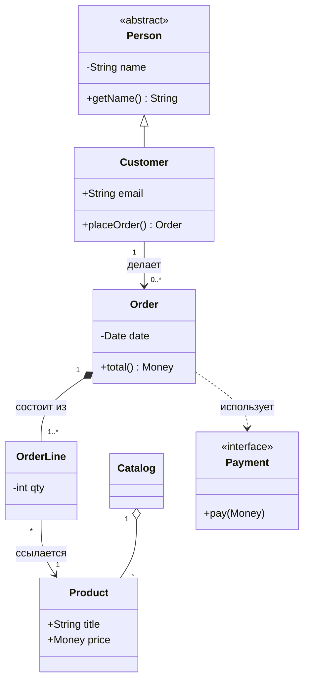
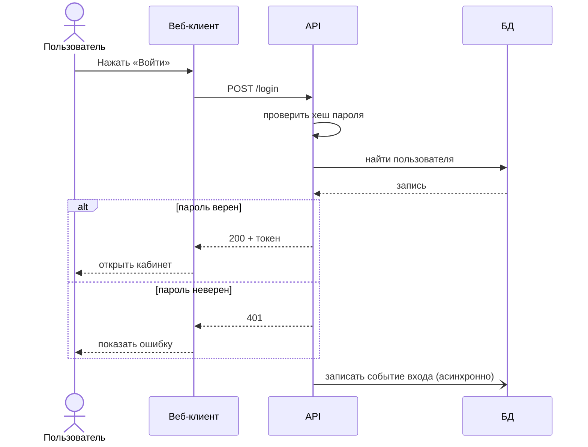
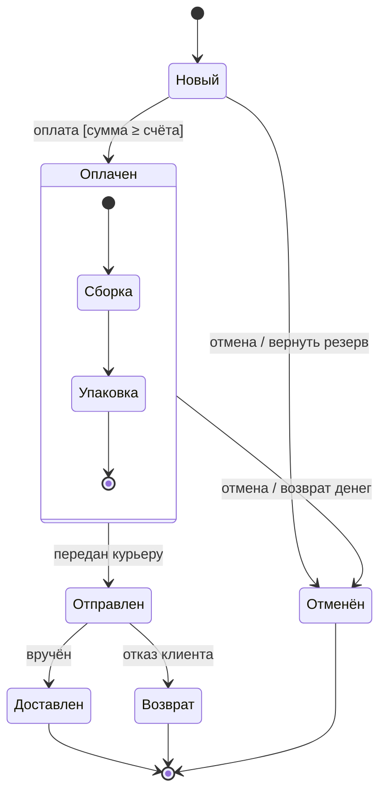
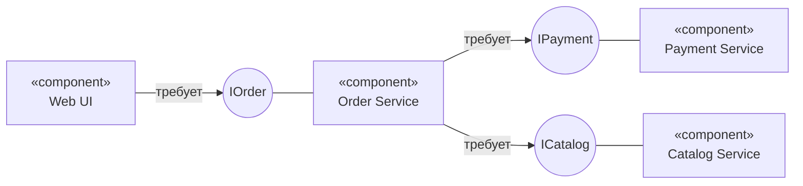
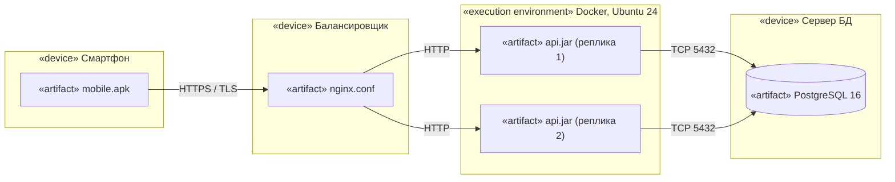

# project_UML

# Семь диаграмм UML

Конспект лекции: назначение, элементы нотации, тонкие места, типичные ошибки и рабочие примеры. Сквозной кейс — интернет-магазин. Каждая диаграмма показана дважды: **Mermaid** (правится прямо в заметке) и **строгая нотация UML в стиле Visio** (SVG из папки `attachments`).

UML (Unified Modeling Language) — язык визуального моделирования. Диаграммы делятся на **структурные** (из чего система состоит) и **поведенческие** (что она делает и как меняется). Разные диаграммы — разные «ракурсы» на одну и ту же систему, поэтому рисовать нужно не все, а те, что отвечают на актуальный вопрос.

### Типичный путь проектирования

Прецеденты (что нужно пользователю) → деятельность (бизнес-процесс) → классы (данные) → последовательности (взаимодействие) → состояния (жизненный цикл) → компоненты (архитектура) → развёртывание (инфраструктура). На практике шаги итеративны.

> [!tip] Главное правило
> диаграмма — средство коммуникации, а не отчётности. Если она не отвечает на конкретный вопрос аудитории, она не нужна. Один рисунок — одна мысль, ориентир 7±2 элемента на уровень детализации.

## 1. Диаграмма прецедентов (Use Case)

> [!question] Вопрос, на который отвечает: «Кто и что делает с системой?»

Описывает функциональные требования с точки зрения внешнего наблюдателя. Система — «чёрный ящик»: внутренности не показываются. Основной язык общения с заказчиком.

### Элементы

- **Актёр** — роль вне системы (человек, внешняя система, таймер). Это роль, а не конкретный человек.
- **Прецедент** — овал с глаголом: законченная ценность для актёра.
- **Граница системы** — прямоугольник.
- **Ассоциация** — линия актёр—прецедент.
- **Include** — обязательное включение (пунктир, стрелка к включаемому).
- **Extend** — необязательное расширение (стрелка к базовому).
- **Обобщение** — наследование актёров или прецедентов.

### Нюансы

- Название — «глагол + объект»: «Оформить заказ», а не «Заказ».
- `include` — общая часть, вынесенная ради повторного использования; `extend` — условный вариант с точкой расширения.
- Стрелки include/extend направлены в противоположные стороны — частая путаница.
- Внешняя система тоже актёр (платёжный шлюз).
- Сама диаграмма мало информативна: ценность — в текстовом сценарии (предусловия, основной и альтернативные потоки, постусловия).
  
![Uploading<svg xmlns="http://www.w3.org/2000/svg" viewBox="0 0 760 320" width="760" height="320"><title>Диаграмма прецедентов</title><defs>
<marker id="ft" markerUnits="userSpaceOnUse" markerWidth="12" markerHeight="10" refX="11" refY="5" orient="auto"><path d="M0,0L11,5L0,10z" fill="#1f2d3d"/></marker>
<marker id="ar" markerUnits="userSpaceOnUse" markerWidth="12" markerHeight="10" refX="10" refY="5" orient="auto"><path d="M0,0L10,5L0,10" fill="none" stroke="#1f2d3d" stroke-width="1.3"/></marker>
<marker id="tr" markerUnits="userSpaceOnUse" markerWidth="15" markerHeight="14" refX="14" refY="7" orient="auto"><path d="M0,0L14,7L0,14z" fill="#fff" stroke="#1f2d3d" stroke-width="1.3"/></marker>
<marker id="df" markerUnits="userSpaceOnUse" markerWidth="20" markerHeight="10" refX="0" refY="5" orient="auto"><path d="M0,5L9,0L18,5L9,10z" fill="#1f2d3d"/></marker>
<marker id="do" markerUnits="userSpaceOnUse" markerWidth="20" markerHeight="10" refX="0" refY="5" orient="auto"><path d="M0,5L9,0L18,5L9,10z" fill="#fff" stroke="#1f2d3d" stroke-width="1.3"/></marker>
<g id="actor"><circle class="b" cx="0" cy="0" r="9"/><path class="l" d="M0,9V34M-14,18H14M0,34L-12,52M0,34L12,52"/></g>
<g id="ci"><rect class="b" width="16" height="12"/><rect class="b" x="-4" y="2" width="8" height="3"/><rect class="b" x="-4" y="7" width="8" height="3"/></g>
</defs><rect width="100%" height="100%" fill="#fff"/>
<rect class="b" x="170" y="10" width="420" height="300"/><text x="180" y="28" class="bd">Интернет-магазин</text>
<use href="#actor" x="70" y="110"/><text x="70" y="182" class="m">Клиент</text>
<use href="#actor" x="690" y="200"/><text x="690" y="272" class="m">Платёжный шлюз</text>
<ellipse class="b" cx="330" cy="55" rx="80" ry="28"/><text x="330" y="59" class="m">Авторизоваться</text>
<ellipse class="b" cx="330" cy="150" rx="80" ry="28"/><text x="330" y="154" class="m">Оформить заказ</text>
<ellipse class="b" cx="330" cy="250" rx="80" ry="28"/><text x="330" y="254" class="m">Оплатить</text>
<ellipse class="b" cx="520" cy="150" rx="62" ry="28"/><text x="520" y="148" class="m">Применить</text><text x="520" y="162" class="m">промокод</text>
<path class="l" d="M82,128L250,150"/><path class="l" d="M676,218L410,250"/>
<path class="l d" d="M330,122V84" marker-end="url(#ar)"/><text x="336" y="106" class="s">«include»</text>
<path class="l d" d="M330,178V221" marker-end="url(#ar)"/><text x="336" y="204" class="s">«include»</text>
<path class="l d" d="M458,150H411" marker-end="url(#ar)"/><text x="434" y="141" class="s m">«extend»</text>
</svg> uml-1-usecase.svg…]()

*Пример: авторизация и оплата обязательны (include), промокод — по желанию (extend). Нотация передана средствами flowchart.*

### Нотация как в Visio

![[uml-1-usecase.svg|760]]

> [!warning] Ошибки
> превращать диаграмму в функциональную декомпозицию (прецедентов 50+); рисовать «Войти в систему» как самоцель; добавлять в прецеденты технические детали («записать в БД»); путать актёра с пользователем-человеком.

## 2. Диаграмма деятельности (Activity)

> [!question] Вопрос: «В каком порядке выполняются действия?»

Расширенная блок-схема: описывает бизнес-процесс или алгоритм, поддерживает параллелизм и распределение ответственности по дорожкам.

### Элементы

- Начальный узел (чёрный круг) и конечные: финал деятельности (⦿) и финал потока (⊗).
- Действие — скруглённый прямоугольник.
- Решение / слияние — ромб; ветви с условиями `[да]`/`[нет]`.
- Fork / Join — жирная черта: разделение и синхронизация параллельных потоков.
- Дорожки (swimlanes) — кто отвечает за действие.
- Объектные узлы, сигналы, регионы прерывания.

### Нюансы

- Семантика — токены (Petri-подобная): переход происходит, когда есть токен.
- Join ждёт **все** входящие потоки; слияние (merge) — любой один.
- Решение не должно «теряться»: у каждой ветви есть условие, одно из них — `[else]`.
- Fork без Join допустим, но требует осознанных финалов потоков.
- Не путать с диаграммой состояний: здесь узлы — действия, а не состояния объекта.

### Схема (Mermaid, редактируется в тексте)

```mermaid
flowchart TD
  st(( )) --> A[Принять заказ]
  A --> D{Товар на складе?}
  D -- нет --> N[Уведомить клиента]
  D -- да --> F[" "]
  F --> B[Собрать товар]
  F --> C[Выставить счёт]
  B --> J[" "]
  C --> J
  J --> E[Отправить заказ]
  E --> en((◉))
  N --> en
  style st fill:#16222e,stroke:#16222e
  style F fill:#b8400f,stroke:#b8400f
  style J fill:#b8400f,stroke:#b8400f
```

*Тёмная точка — старт, оранжевые черты — Fork и Join: сборка и выставление счёта идут параллельно.*

### Нотация как в Visio

![[uml-2-activity.svg|760]]

> [!warning] Ошибки
> Join после решения (поток никогда не придёт — взаимоблокировка); слишком мелкие действия («нажать кнопку»); отсутствие дорожек при нескольких исполнителях.

## 3. Диаграмма классов (Class)

> [!question] Вопрос: «Какие сущности есть и как они связаны?»

Самая используемая диаграмма: статическая структура системы, основа для кода и БД. Три уровня детализации: концептуальный (предметная область), спецификации и реализации.

### Элементы

- Класс: имя / атрибуты / операции. Курсивом — абстрактный, `«interface»` — интерфейс.
- Видимость: `+` public, `−` private, `#` protected, `~` package.
- Кратность: `1`, `0..1`, `*`, `1..*`.
- Отношения: ассоциация, агрегация, композиция, обобщение, реализация, зависимость.

### Нюансы отношений

- **Композиция** (закрашенный ромб) — часть не живёт без целого: заказ → строки заказа.
- **Агрегация** (пустой ромб) — часть живёт сама: каталог → товары. Многие архитекторы советуют обходиться ассоциацией.
- **Обобщение** — «является» (замкнутая стрелка), **реализация** — пунктир с пустой стрелкой.
- **Зависимость** — самая слабая: класс лишь использует другой.
- Стрелка у ассоциации — направление навигации.

### Схема (Mermaid, редактируется в тексте)

*Наследование, ассоциация, композиция, агрегация, зависимость — в одном примере.*

### Нотация как в Visio

![[uml-3-class.svg|760]]

> [!warning] Ошибки
> «все геттеры и сеттеры» на схеме; композиция там, где часть может жить отдельно; двунаправленные связи по умолчанию; неотражённые кратности; «божественный класс».

## 4. Диаграмма последовательностей (Sequence)

> [!question] Вопрос: «Кто кому и в каком порядке отправляет сообщения?»

Время течёт сверху вниз. Показывает взаимодействие объектов в рамках одного сценария — идеальна для описания API-вызовов и протоколов.

### Элементы

- **Линия жизни** — вертикальный пунктир под участником.
- **Активация** — узкий прямоугольник: объект выполняет работу.
- Сообщения: синхронное (сплошная, закрашенная стрелка), асинхронное (открытая стрелка), ответ (пунктир), создание, уничтожение (✕), вызов самого себя.
- **Фрагменты**: `alt` (если-иначе), `opt`, `loop`, `par`, `ref`.

### Нюансы

- Одна диаграмма — один сценарий; ветвления выносите во фрагменты, а не множите стрелки.
- Порядок важен только вдоль одной линии жизни; между разными линиями — лишь через сообщения.
- Различайте синхронный (ждём ответа) и асинхронный вызов — для распределённых систем критично.
- Сообщения называйте именем операции из диаграммы классов.
- Не больше 5–7 участников на схеме.

### Схема (Mermaid, редактируется в тексте)

*Сценарий входа: самовызов, фрагмент alt, ответные сообщения и асинхронная запись в журнал.*

### Нотация как в Visio

![[uml-4-sequence.svg|760]]

> [!warning] Ошибки
> пытаться уместить весь процесс; забывать ответы на синхронные вызовы; рисовать «объект вызывает класс», не указывая экземпляр; смешивать уровни абстракции в одной схеме.

## 5. Диаграмма состояний (State Machine)

> [!question] Вопрос: «Какие состояния проходит объект и что вызывает переходы?»

Конечный автомат одного объекта или подсистемы: заказ, документ, соединение, интерфейсный экран. Рисуется для сущностей со сложным жизненным циклом.

### Элементы

- Состояние — скруглённый прямоугольник; начальное (●) и конечное (⦿).
- Переход: `событие [условие] / действие`.
- Внутренние действия: `entry`, `exit`, `do`.
- Составные состояния (вложенные автоматы), параллельные регионы.
- Псевдосостояния: выбор, история (H), вход, выход.

### Нюансы

- Состояние — это промежуток времени, в котором объект «чего-то ждёт» или «что-то делает», а не момент.
- Из состояния должен быть выход, кроме конечного; иначе — «тупик».
- Охранные условия на переходах с одним событием не должны пересекаться.
- Вложенность убирает дублирование: общий переход (например, «отмена») рисуют на внешнем состоянии.
- Не путать с деятельностью: тут узлы — состояния, дуги — события.

### Схема (Mermaid, редактируется в тексте)

*Жизненный цикл заказа с вложенным автоматом «Оплачен» и действиями на переходах.*

### Нотация как в Visio

![[uml-5-state.svg|760]]

> [!warning] Ошибки
> путать состояние и действие («Оплата» вместо «Оплачен»); «лес» переходов без вложенных состояний; отсутствие условий на ветвлениях.

## 6. Диаграмма компонентов (Component)

> [!question] Вопрос: «Из каких модулей собрана система и через какие интерфейсы они общаются?»

Архитектурный вид на уровне заменяемых частей: сервисы, библиотеки, подсистемы. Фокус — на интерфейсах и зависимостях, а не на внутренностях.

### Элементы

- **Компонент** — прямоугольник с «вилкой» или `«component»`.
- **Предоставляемый интерфейс** — «леденец» (круг на стержне).
- **Требуемый интерфейс** — «гнездо» (полукруг).
- **Порт** — точка взаимодействия на границе.
- Коннекторы сборки и делегирования; артефакты и пакеты.

### Нюансы

- Компонент — заменяемая единица: если реализация подменима при том же интерфейсе, вы выделили компонент правильно.
- Зависимости идут в сторону стабильных интерфейсов, а не реализаций.
- Циклические зависимости между компонентами — признак плохого разреза.
- Не путать с диаграммой классов: компонент может содержать десятки классов.

### Схема (Mermaid, редактируется в тексте)

*Круги — интерфейсы: линия «требует» идёт от потребителя, простая линия — от поставщика («леденец» и «гнездо» заменены подписями).*

### Нотация как в Visio

![[uml-6-component.svg|760]]

> [!warning] Ошибки
> рисовать классы под видом компонентов; общая БД как скрытая связь между компонентами; интерфейсы без описания контракта.

## 7. Диаграмма развёртывания (Deployment)

> [!question] Вопрос: «Что и на каком оборудовании запускается?»

Физическая архитектура: узлы, среды выполнения, артефакты и сетевые связи. Нужна администраторам, DevOps и для оценки отказоустойчивости.

### Элементы

- **Узел (Node)** — 3D-параллелепипед: `«device»` (оборудование) или `«execution environment»` (ОС, JVM, контейнер).
- **Артефакт** — файл: jar, war, apk, образ, конфиг; `«artifact»`.
- **Связь** узлов — линия с протоколом: HTTPS, TCP, AMQP.
- **Манифестация** — связь компонент → артефакт.

### Нюансы

- Различайте **тип** узла (шаблон) и **экземпляр** (`app-1 : AppServer`).
- Показывайте только значимое: балансировщик, реплики, границы сетей, а не каждый порт.
- Подписывайте протокол и направление соединения.
- Артефакт ≠ компонент: компонент — логика, артефакт — физический файл.

### Схема (Mermaid, редактируется в тексте)

*Трёхзвенная схема: клиент, балансировщик, две реплики приложения и база данных.*

### Нотация как в Visio

![[uml-7-deployment.svg|760]]

> [!warning] Ошибки
> смешивать логические компоненты и физические узлы; не указывать протоколы; рисовать всю инфраструктуру в одной схеме.

